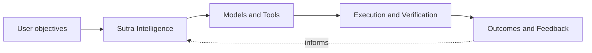

# SUTRA INTELLIGENCE

### The Intelligence Control Architecture for AI.

**Make AI systems more deliberate, dependable and efficient.**

SUTRA is an independent, model-agnostic intelligence architecture being developed to coordinate how AI systems understand objectives, work with context, choose appropriate capabilities, carry out tasks, check results and communicate what actually happened.

It is designed to work **around AI models**, not to replace them. SUTRA aims to bring structure, direction and accountability to the systems that use AI.

  <a href="https://rishavm713-create.github.io/sutra-intelligence-site/"><strong>Explore the official website →</strong></a>

**Inspired by Indian philosophy.** Many parts, held together by one thread.

> Ancient in philosophical inspiration. Futuristic in engineering. Independent in intelligence.

---

## What is SUTRA?

Today's AI systems can generate, analyse and create. But completing a meaningful task often requires more than generating an answer: a system must understand the goal, keep the right context, choose suitable tools, respect constraints, manage steps, check its work and acknowledge uncertainty.

SUTRA is being developed to provide that coordinating intelligence layer.

It is not another foundation model, a standalone chatbot or a collection of prompts. It is intended as a reusable control architecture that can work with different models, software tools and product environments.

## What SUTRA is designed to do

| Capability | What it means in practice |
|---|---|
| **Understand the objective** | Interpret what needs to be achieved, along with the user's constraints and success criteria. |
| **Maintain useful context** | Keep relevant task information available without carrying unnecessary history into every step. |
| **Work with evidence** | Keep track of what is known, what is reported, what is inferred and what remains uncertain. |
| **Respect instructions and boundaries** | Account for priorities, permissions, constraints and situations that require human approval. |
| **Organise complex work** | Break larger objectives into manageable stages, understand dependencies and identify blockers. |
| **Choose an appropriate capability** | Coordinate AI models, deterministic software and external tools according to the task. |
| **Execute with discipline** | Reduce avoidable repetition and use resources in proportion to the task. |
| **Check the result** | Compare completed work with the intended outcome and available verification evidence. |
| **Respond to failures** | Recognise unsuccessful steps, recover within limits or escalate when necessary. |
| **Report accurately** | Distinguish what was attempted, completed, failed and actually verified. |
| **Improve through feedback** | Preserve outcomes and support controlled, evidence-led improvement over time. |

These are design objectives and areas of development—not a claim that every capability is complete or proven in production.

## Why an intelligence control architecture?

A capable model does not automatically make the complete system around it reliable. Real tasks involve instructions, information, tools, dependencies, permissions, costs and consequences.

SUTRA focuses on the system around the model:

- **Direction:** keep work aligned with the original objective.
- **Context:** use information that is relevant to the task.
- **Evidence:** avoid presenting assumptions as established facts.
- **Coordination:** select suitable models and tools instead of relying on one approach for everything.
- **Verification:** do not confuse a generated answer or attempted action with a successful result.
- **Efficiency:** use the least expensive sufficient path, escalating only when needed.
- **Accountability:** communicate limitations, failures and completion status honestly.

The aim is not to make every task more complicated. Simple tasks should remain simple. More complex or consequential tasks should receive the additional planning, checking and oversight they require.

## Designed for many kinds of AI products

A shared intelligence architecture can support different products without requiring them to expose the same interface or workflow.

Potential application areas include:

- **AI development environments** — coordinate coding, debugging, tool use and verification.
- **Learning and research systems** — support structured exploration, evidence-aware explanations and guided work.
- **Creative production tools** — coordinate multi-stage content, design and media workflows.
- **Business and productivity software** — manage objectives, documents, processes and approvals.
- **Automation systems** — coordinate tasks, dependencies, execution and recovery.
- **Specialist AI applications** — provide a common control foundation while allowing product-specific behaviour.

These are intended application areas. Availability and effectiveness depend on the implementation and evaluation of each product integration.

## Our design principles

**Model independence**  
SUTRA is being designed to work across different AI models and providers rather than depending on one model.

**Task-appropriate intelligence**  
Use deterministic software for deterministic work, and AI reasoning where it adds value.

**Evidence before confidence**  
Preserve uncertainty and make verification meaningful.

**Human authority where it matters**  
Consequential actions should respect permissions and approval boundaries.

**Efficiency by design**  
Avoid unnecessary model calls, repeated operations and needless complexity.

**Honest reporting**  
A system should say what it did—and what it could not establish.

**Measured progress**  
Retain mechanisms because they demonstrate value, not because they sound compelling.

## Philosophy and identity

The name SUTRA draws inspiration from the idea of a thread: a principle that connects separate parts into a coherent whole.

The visual identity takes inspiration from Indian philosophical thought, Sanskrit and sacred geometry. The expression **अहं ब्रह्मास्मि** appears as a philosophical motif in the brand experience.

This inspiration is not a claim of ownership over Sanskrit, traditional symbols, ancient texts or philosophical traditions. The proprietary claims described below concern original project materials and independently created work, subject to applicable law.

## Development status

Each stage of maturity is separate. Passing tests does not mean validation.

| Level | Status for SUTRA |
|---|---|
| Implemented | Early prototype exists (private) |
| Unit tested | Yes, on synthetic cases only |
| Integration tested | Not established in public material |
| Benchmarked | No |
| Independently validated | No |
| Planned | Real-world evaluation, wider model and tool support |
| Unproven | The core hypothesis: that a model-independent control layer makes AI work more reliable and less wasteful |

No claim is made about improved reasoning, accuracy, speed, cost, token savings or reliability, and none that SUTRA is better than other AI systems.

## In simple words

AI tools are clever but can lose track of what you asked, repeat themselves, mark their own work as correct, or say "done" too early. SUTRA is an early idea for a supervisor that sits above them. It remembers what you want, picks the right tool for each step, has someone else check the result, and tells you honestly what is and is not finished. It is a prototype and **not yet proven**. It is not a new AI, and nothing here says it is faster, cheaper or better.

## Conceptual architecture

SUTRA sits between a person's objective and the models and tools used to fulfil it. This is a public, conceptual view only.

## The Indian philosophy behind each stage

SUTRA is inspired by ideas from Indian thought. These are inspirations for how we think about the design, not claims about what the software achieves.

| Stage | Idea that inspires it | In simple words |
|---|---|---|
| User objectives | **Dharma** (purpose, right duty) | Know clearly what the work is for, and stay true to it. |
| SUTRA Intelligence | **Viveka** (discernment) | Tell what matters from what does not, and choose wisely. |
| Models and Tools | **Yoga** (union, disciplined harmony) | Many different abilities working together as one. |
| Execution and Verification | **Pramana** (valid ways of knowing) | Do not just believe a result; check it properly. |
| Outcomes and Feedback | **Karma** (action and its result) | Every action has a result, and we learn from it. |

Careful explanations, limits and sources are in [docs/PHILOSOPHY.md](docs/PHILOSOPHY.md).

Running through all of it is **Satya** (truthfulness): saying honestly what is done and what is not. The word *sutra* itself means a thread that joins many beads into one garland.

These traditions belong to everyone. We honour them and claim only our own original work.

## Founder

**Rishav Mishra**, Founder & Architect, SUTRA INTELLIGENCE. His motivation is in [docs/WHY-SUTRA.md](docs/WHY-SUTRA.md) and on the [website](https://rishavm713-create.github.io/sutra-intelligence-site/#founder).

## Documentation

[Why Sutra](docs/WHY-SUTRA.md) · [Philosophy](docs/PHILOSOPHY.md) · [Capabilities](docs/CAPABILITIES.md) · [Architecture overview](docs/ARCHITECTURE-OVERVIEW.md) · [Use cases](docs/USE-CASES.md) · [Roadmap](docs/ROADMAP.md) · [FAQ](docs/FAQ.md) · [Copyright](COPYRIGHT.md) · [Trademark](TRADEMARK.md)

## What this repository contains

This is the **public-facing website and brand repository** for SUTRA INTELLIGENCE.

It does not contain:

- Sutra Core source code or executable implementation.
- Private operating specifications.
- Private research notes, development logs or internal design documents.
- Non-public evaluation data, experiments or proprietary engineering materials.

The public description explains the project's purpose and intended capabilities without publishing its confidential implementation.

## Project links

- **Official website:** [SUTRA INTELLIGENCE](https://rishavm713-create.github.io/sutra-intelligence-site/)
- **Public website repository:** [GitHub repository](https://github.com/rishavm713-create/sutra-intelligence-site)

## Ownership and use

**© 2026 Rishav Mishra. All rights reserved.**

SUTRA INTELLIGENCE is a brand of Rishav Mishra. The name, branding, artwork, website and written materials are original work, protected and reserved to their owner.

Permission to use any of it is available on request. See [LICENSE](LICENSE) and [COPYRIGHT.md](COPYRIGHT.md).

**Inspired by Indian philosophy.** SUTRA takes its name and spirit from India's ancient thinking: many parts held together by one thread, with discipline and clarity of purpose. That heritage belongs to everyone; we honour it and claim only our own original work.

---

  <strong>SUTRA INTELLIGENCE</strong> 
  <em>The Intelligence Control Architecture for AI.</em>  
  <a href="https://rishavm713-create.github.io/sutra-intelligence-site/">Visit the official website</a>

