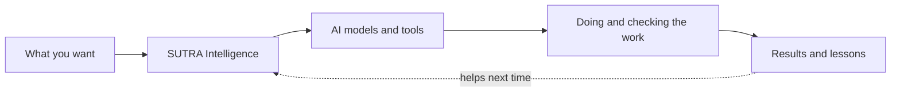

# How SUTRA fits together

[← Back to README](../README.md)

A simple picture. The private details are deliberately left out.



```
What you want → SUTRA Intelligence → AI models and tools
              → Doing and checking the work → Results and lessons
```

Think of building a house.

1. **What you want (User objectives)** – You describe the house. This is the plan everyone must follow.
2. **SUTRA Intelligence** – The site manager. Keeps your wishes in mind, gathers what is needed, and decides who does what.
3. **AI models and tools** – The workers and equipment. The manager picks the right ones, from any supplier.
4. **Doing and checking the work (Execution and Verification)** – Workers build; a different person inspects. If something goes wrong, they try again a few times, then call you.
5. **Results and lessons (Outcomes and Feedback)** – You get the house with an honest list of anything unfinished, and lessons are kept for the next job.

## The Indian ideas behind it

Each stage is inspired by an idea from Indian philosophy: **Dharma** (purpose) for what you want, **Viveka** (discernment) for the supervisor, **Yoga** (harmony) for tools working together, **Pramana** (valid ways of knowing) for checking, and **Karma** (action and result) for lessons learned. **Satya** (truthfulness) runs through all of it. These are inspirations only, and belong to everyone.

## Why this shape?

- One manager keeps the job on track.
- Workers can be swapped without changing the plan.
- Inspection is separate from building.
- Problems are reported, not hidden.

## Status

An early prototype and an unproven idea.

---
© 2026 Rishav Mishra. All rights reserved.
