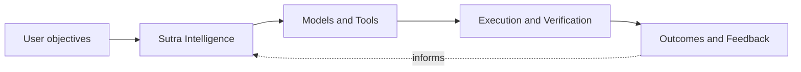

# Architecture Overview

[← Back to README](../README.md)

A conceptual view only. Internal components, interfaces, rules and mechanisms are intentionally not described, and are not published.

## Five stages



```
User objectives → Sutra Intelligence → Models and Tools
                → Execution and Verification → Outcomes and Feedback
```

## 1. User objectives

**Responsibility:** receive what the person wants, with their constraints, in their terms.
**Benefit:** a single, clear reference for everything that follows.

## 2. Sutra Intelligence

**Responsibility:** keep the objective steady; gather context and evidence; shape a plan; decide what kind of work should go where.
**Benefit:** one coordinating point, instead of disconnected model calls that each start from scratch.

## 3. Models and Tools

**Responsibility:** the AI models and tools that actually have capabilities. Sutra selects among them per piece of work.
**Benefit:** the right capability for the job, and no dependence on one vendor.

## 4. Execution and Verification

**Responsibility:** carry the work out, and check it separately from whatever produced it. When something fails, retry within limits and escalate to a human rather than hide it.
**Benefit:** results are not simply self-approved; failures are visible.

## 5. Outcomes and Feedback

**Responsibility:** deliver the result with an honest statement of what is complete and what is not, and return what was learned to the process.
**Benefit:** incomplete work is labelled, and experience is not discarded.

## Model independence

Stages 2, 4 and 5 are meant to stay the same when the models in stage 3 change. That separation is the point of the design.

## Status

Prototype. The architecture is a hypothesis about how to organise AI work. It is unbenchmarked and unproven.

---
© 2026 Rishav Mishra. All rights reserved.
